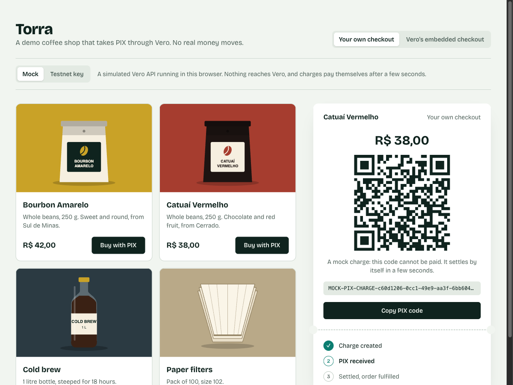

# Vero checkout example

A small demo shop that takes PIX payments with [Vero](https://vero.finance). It shows both checkout options from the [Vero PIX integration guide](https://api.testnet.vero.finance/integrations/pix) side by side:

- **Your own checkout** (option A): your page draws the QR code, the copy button and the expiry timer from the charge Vero returns.
- **Vero's embedded checkout** (option B): Vero draws the payment screen in an iframe on your page.

**[Try the live demo](https://verofinance.github.io/vero-checkout/)**. It starts in mock mode, so you can click through a whole purchase without an account.



## Payments modes

The shop can send its orders to three places. You pick one in the bar under the header.

| Mode | What it calls | Needs |
| --- | --- | --- |
| **Mock** (default) | A simulated Vero API inside your browser. Nothing reaches Vero. Each charge pays itself after about 10 seconds. | Nothing |
| **Testnet key** | Vero's testnet, straight from your browser, with a key you paste. The key is kept in that browser tab only. | A Vero testnet API key |
| **Local server** | This app's own server, which holds the key and talks to Vero. Offered only when you run the server with a key. | Bun, and a key in `.env` |

Mock is the default so that the public demo does not fill Vero's testnet with charges. No real money moves in any mode.

**Local server is the one to copy.** In a real integration the API key stays on your server and never reaches a browser. Testnet key mode breaks that rule on purpose, so the demo can run on a static host: only use it with a testnet key.

In mock mode, the embedded checkout tab shows a placeholder, because Vero's iframe needs a real charge to display.

## Run it locally

You need [Bun](https://bun.com).

```bash
bun install
bun dev
```

Open [http://localhost:3000](http://localhost:3000). That is enough for mock mode.

To use the local server against testnet:

1. Sign in at [testnet.vero.finance](https://testnet.vero.finance), open Company Settings, then the Developer tab, and generate an API key. Vero shows it once, so copy it then. You need the Owner, Admin or Manager role to see the tab.
2. Copy `.env.example` to `.env` and paste the key into `VERO_API_KEY`.
3. Restart `bun dev` and choose **Local server** in the payments bar.

On testnet you don't need to pay: in our runs each charge settled by itself in about 15 seconds.

## How a real integration works

This is the Local server mode. The browser never talks to Vero and never sees the API key.

```
Browser                     Your server                      Vero API
   │  POST /api/orders          │                               │
   │ ─────────────────────────> │  POST /payments/onramp        │
   │                            │ ────────────────────────────> │
   │                            │  payment id, br_code, expiry  │
   │  order (saved server-side) │ <──────────────────────────── │
   │ <───────────────────────── │                               │
   │                            │                               │
   │  GET /api/orders/:id       │                               │
   │  (every 5 seconds)         │  GET /payments/:id            │
   │ ─────────────────────────> │ ────────────────────────────> │
   │                            │  status                       │
   │  order                     │ <──────────────────────────── │
   │ <───────────────────────── │  fulfil only if SETTLED       │
```

Three rules do the important work, and they are the ones to keep when you copy this into your application:

1. **The API key stays on the server.** `src/index.ts` reads `VERO_API_KEY` and nothing sends it to the browser.
2. **An order is fulfilled only when your server reads `SETTLED`** from `GET /payments/:id`. Nothing the browser says counts, including the embedded checkout's `completed` event, which this example treats as a hint to check again.
3. **The server reconciles the payment id it saved**, never one sent by the browser. The browser only knows the order id.

Both checkouts use the same order code. They differ only in what the browser draws while the customer pays, so you can start with the embedded checkout and move to your own later without touching the backend.

### Payment statuses

| Status | Meaning | Final |
| --- | --- | --- |
| `INITIATED` | Created, charge being prepared | No |
| `AWAITING_FUNDS` | Waiting for the customer to pay | No |
| `PROCESSING` | PIX received, being settled | No |
| `SETTLED` | Paid. Fulfil the order | Yes |
| `EXPIRED`, `FAILED`, `CANCELLED` | Not paid. Let the customer try again | Yes |

## The code

| File | What it does |
| --- | --- |
| `src/vero.ts` | The Vero client: `createCharge` and `getPayment`. |
| `src/orders.ts` | Creates orders and reconciles them. The fulfilment rule lives here. |
| `src/index.ts` | The server and its three routes. Holds the key. |
| `src/mockVero.ts` | The simulated Vero API used by mock mode. |
| `src/backend.ts` | Sends the page's orders to the mock, to testnet or to the server, depending on the mode. |
| `src/products.ts` | The fixed product list, with prices. Pictures are in `src/images`. |
| `src/App.tsx` | The shop page: checkout tabs, payments mode, product list, status tracker, polling. |
| `src/PixCode.tsx` | Your own checkout: QR code, copy button, expiry timer. |
| `src/VeroEmbed.tsx` | Vero's embedded checkout: loads the script and mounts the iframe. |
| `src/orders.test.ts` | Checks that an order is fulfilled on `SETTLED` and not before. |

`src/orders.ts` takes the Vero client as an argument. That is why the same order code runs on the server with the real client and in the browser with the mock.

### Server routes

| Route | What it does |
| --- | --- |
| `POST /api/orders` | Body `{ productId }`. Looks up the price in the catalogue, then creates a PIX charge and an order. The browser never sends an amount. |
| `GET /api/orders/:id` | Reconciles the order with Vero and returns it. Fulfils it if Vero reports `SETTLED`. |
| `GET /api/config` | Tells the page whether the server has a key, and which host the embedded checkout loads from. |

## Add it to your application

1. Copy `src/vero.ts` to your server and create the client with your key: `veroClient(process.env.VERO_API_KEY)`. It has no dependencies beyond `fetch`.
2. When a customer checks out, work out the amount on the server (it is in reais, minimum 10), call `createCharge(amount, description)` once and save the returned payment `id` on your order. A page refresh should reuse that charge, not create another. This example keeps the order id in the URL for that.
3. Add a reconcile step like `reconcileOrder` in `src/orders.ts`: read the payment with `getPayment`, and fulfil the order when the status is `SETTLED`. Make fulfilment safe to run twice.
4. Pick a payment screen. Copy `src/PixCode.tsx` to draw your own, or `src/VeroEmbed.tsx` to mount Vero's.
5. Have the browser ask your server for the order every 5 to 10 seconds while the customer is on the page, and stop on a final status.

Replace the in-memory `Map` in `src/orders.ts` with your database. As written, orders are lost when the server restarts, and a customer who closes the tab is only reconciled if they come back. In production, also reconcile unfinished orders from a background job.

## Go live

Change three values on your server and nothing else:

| Variable | Testnet | Production |
| --- | --- | --- |
| `VERO_API_URL` | `https://api.testnet.vero.finance` | `https://api.vero.finance` |
| `VERO_EMBED_HOST` | `https://testnet.vero.finance` | `https://app.vero.finance` |
| `VERO_API_KEY` | A testnet key | A production key from [app.vero.finance](https://app.vero.finance) |

Keys belong to one environment and do not work in the other. Before you switch, check that:

- the key is in a secret store, not in the repository or the browser bundle;
- each order saves its payment id, and one order creates one charge;
- orders are fulfilled only after the server reads `SETTLED`;
- an expired or failed charge lets the customer start again;
- the `request_id` from every Vero error is logged (`src/vero.ts` does this), since Vero support asks for it.

## Deploy the demo to GitHub Pages

```bash
bun run deploy
```

This builds the page into `dist` and pushes it to the `gh-pages` branch with the [gh-pages](https://github.com/tschaub/gh-pages) tool. GitHub Pages hosts static files only, so the hosted demo has no server: it offers Mock and Testnet key, and not Local server.

## Troubleshooting

| What you see | Cause |
| --- | --- |
| No **Local server** option | The server is not running, or `.env` has no `VERO_API_KEY`. |
| "This API key isn't valid or has been revoked" | Wrong key, or a production key used against testnet. |
| `subaccount.below_minimum` (400) | The amount is under R$ 10. |
| `subaccount.unsupported_operation` (400) | PIX is not enabled for your company. Contact Vero. |
| `payment.not_found` (404) | The payment id is unknown, or belongs to another company. |

## Scripts

```bash
bun dev          # start the server with hot reload
bun start        # start the server in production mode
bun test         # run the tests
bun check        # type check
bun run deploy   # publish the static demo to GitHub Pages
```

## Not covered

PIX payouts (`POST /payments/offramp`) and balance checks are in the [guide](https://api.testnet.vero.finance/integrations/pix) but not in this example.

## License

[MIT](LICENSE). Copy any part of this into your own application.
